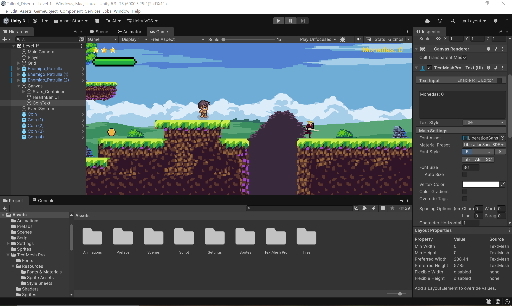

# Taller 6: Sistema de Recolección de Monedas y Contador UI

> **Aviso Académico:** Este proyecto ha sido desarrollado exclusivamente con fines formativos y académicos dentro del curso de Diseño y Desarrollo de Videojuegos 2D. Todos los recursos empleados se utilizan con propósito educativo.

Proyecto desarrollado en Unity 2D (Unity 6). En este taller se implementa un sistema completo de recolección de monedas con detección por colisión (*Trigger*), animación cíclica por sprites y actualización dinámica de la interfaz de usuario (UI) en tiempo real mediante *TextMeshPro*.

---

## 📹 Video de Demostración
- **Video en Google Drive:** [Taller_6.mp4 - Google Drive](https://drive.google.com/file/d/1uL3ixW7WMi2Gy4WQC66_0sj1-N_Tdv4W)  
*(El enlace también se encuentra respaldado en el archivo `Entregables/Enlace_Video.txt`)*

---

## 🖼️ Evidencias del Proyecto

### 1. Prefab de Moneda y Script Asociado
Configuración del componente `CircleCollider2D` con `Is Trigger` activado y vinculación del script `Coin.cs`:


### 2. Contador de Monedas en UI y Escena
Configuración del elemento `CoinText` en Canvas con anclaje superior derecho (*Top-Right*) y monedas distribuidas en el nivel:


---

## 🚀 Características Implementadas

1. **Monedas Coleccionables (`Coin.prefab`):**
   - Animación de rotación continua (`Coin_Idle`) a partir de hoja de sprites recortada con filtro *Point (no filter)*.
   - Componente `CircleCollider2D` configurado en modo **`Is Trigger`** para permitir que el personaje atraviese el objeto y active el evento sin frenar su desplazamiento ni generar colisión física sólida.
   - Múltiples instancias del prefab distribuidas a lo largo de las plataformas del nivel.

2. **Detección y Lógica de Recolección (`Coin.cs`):**
   - Detección precisa mediante la etiqueta estandarizada `Tag: "Player"`, asegurando que únicamente el jugador pueda recolectar los ítems.
   - Comunicación con el gestor de UI para sumar unidades al contador.
   - Destrucción inmediata del GameObject al ser recogido mediante `Destroy(gameObject)`.

3. **Interfaz de Usuario y Contador Dinámico (`CoinUI.cs`):**
   - Objeto `CoinText` creado con *TextMeshPro* posicionado en la esquina superior derecha con *Anchor Top-Right*.
   - Implementación del patrón *Singleton* (`CoinUI.instance`) para una comunicación directa y desacoplada desde el script de cada moneda.
   - Actualización en tiempo real del texto en pantalla (`Monedas: X`) cada vez que se recolecta una moneda.

4. **Integración con Sistemas Previos:**
   - Compatibilidad total con el sistema de vidas dual (barra de salud / contenedor de estrellas) y las patrullas enemigas sin interferencias en físicas ni tags.

---

## 📂 Estructura del Repositorio

El proyecto incluye las carpetas requeridas para abrirse directamente en Unity sin pérdida de referencias:

```text
├── Assets/                 # Carpeta completa de assets y sus archivos .meta
│   ├── Animations/
│   ├── Prefabs/
│   ├── Scenes/
│   ├── Script/
│   ├── Sprites/
│   └── TextMesh Pro/
├── ProjectSettings/        # Configuración global del motor (Tags, Layers, Input, etc.)
├── Entregables/            # Capturas de evidencia y enlace de video
│   ├── Coin con Script.jpg
│   ├── CoinsText.jpg
│   └── Enlace_Video.txt
├── .gitignore              # Filtro para omitir archivos temporales y carpetas pesadas (Library, Temp, obj)
└── README.md


🛠️ Cómo Abrir el Proyecto en Unity

1. Clona este repositorio o descarga el archivo ZIP:
```bash
git clone [https://github.com/luisAristeguieta/Scrip_Animation.git](https://github.com/luisAristeguieta/Scrip_Animation.git)

2. Abre Unity Hub.
3. Haz clic en Add > Add project from disk.
4. Selecciona la carpeta raíz del repositorio clonado.
5. Abre el proyecto con Unity 6 (o versión compatible).
6. Dirígete a Assets/Scenes/ y abre la escena principal Level 1.unity.
7. Presiona Play para interactuar con el nivel y probar la recolección de monedas.
